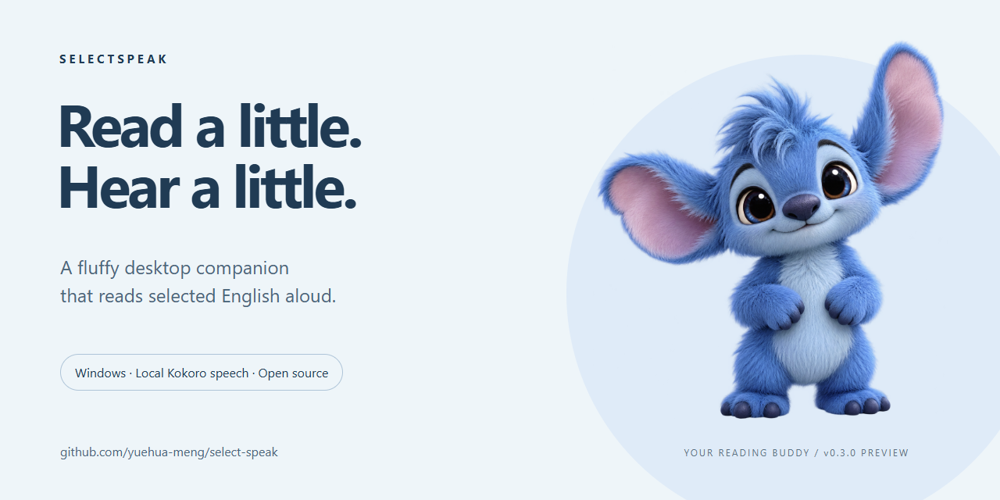
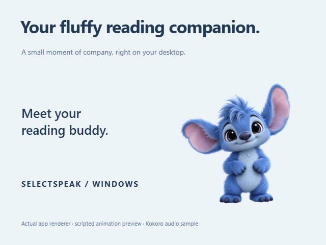

# SelectSpeak

**A fluffy desktop companion that reads selected English aloud.**

Select English text, click the floating speaker, and listen with local Kokoro speech. Keep a little blue companion on your Windows desktop while you read.

[Download Windows preview](https://github.com/yuehua-meng/select-speak/releases/tag/v0.3.0) · [中文说明](README.zh-CN.md) · [Report compatibility](https://github.com/yuehua-meng/select-speak/issues/new?template=compatibility.yml)



**Windows 10/11 x64 · Free source code · Local CPU speech · No API key · MIT source license**

## See the companion



Single-click to pat; double-click for a happy bounce. Drag to move, or right-click for speech controls, voice selection, size and visibility. The companion reacts to speech generation and playback.

This animation preview captures the app renderer with scripted interactions. It does not demonstrate native text selection in another application. The character uses the selected transparent image with whole-image animations.

[Watch the preview with a real Kokoro audio sample](https://github.com/yuehua-meng/select-speak/releases/download/v0.3.0/SelectSpeak-companion-preview.mp4) · [Listen to Heart](docs/media/kokoro-heart-sample.wav)

## Try it on Windows

1. Download **SelectSpeak-0.3.0-windows-x64.zip** from the [preview release](https://github.com/yuehua-meng/select-speak/releases/tag/v0.3.0).
2. Extract the entire folder and run **SelectSpeak.exe**. Keep the `resources` folder beside it.
3. Wait for Kokoro to finish loading. Select an English word in another application, release the mouse, and click the floating speaker.

The ZIP includes the runtime and speech model; Node.js, Python, a GPU and an API account are not required. It is a portable, unsigned preview build. Compare your download with the release's `SHA256SUMS.txt` to verify it.

**The application interface is currently primarily Simplified Chinese.** This README and the download's quick-start guide explain the controls in English. English UI localization is open for contributions.

## What it does

- Reads selected English words and sentences through a small, non-activating speaker window.
- Runs Kokoro-82M ONNX at FP32 precision on the CPU, in a separate process.
- Offers Heart, Bella and Michael for American English; Emma and George for British English.
- Supports playback speed, stop, sentence chunking and bounded in-memory audio caching.
- Keeps the companion and speech controls available through a tray menu.
- Uses Windows accessibility interfaces for selection, with optional clipboard fallback for an application allowlist.

Runtime speech uses local model files, disables remote model loading and blocks the synthesis worker's fetch. The app does not upload selected text. The development model-download command does use the network.

## Compatibility and current limits

This is an early Windows preview. The selection mechanism targets readers, editors and browsers that expose selectable text; compatibility depends on the application and document. **Word, PDF readers and Markdown editors have not yet been exhaustively verified across versions.** See the [compatibility matrix and test procedure](docs/COMPATIBILITY.md).

- Scanned PDFs, protected documents and elevated applications may not expose text.
- Clipboard fallback may leave an entry in clipboard history even when clipboard contents are restored.
- English voices are intended for English. Pronunciation of names, isolated ambiguous words and mixed-language passages needs listening checks.
- macOS and Linux are not supported by this preview.

## Workbench


The workbench lets you choose voices, adjust speed, manage application lists and stop speech. Closing it keeps the application in the tray. Use **退出程序** or the tray's **退出** to quit.

## Build from source

Requirements: **Windows x64, Node.js 24 and npm**.

```powershell
git clone https://github.com/yuehua-meng/select-speak.git
cd select-speak
npm ci
npm run model:download
npm test
npm start
```

The model-download command downloads pinned files and checks their hashes. It tries Hugging Face and then hf-mirror.com; set `HF_ENDPOINT` to choose the origin. Model files, dependencies, personal settings and generated builds are excluded from Git.

```powershell
npm run test:kokoro  # real offline synthesis tests; produces WAV samples
npm run smoke        # starts Electron, tests playback and companion; makes sound
npm run pack         # produces release/win-unpacked/
```

The complete ONNX model is approximately 326 MB. The distribution also contains Electron and native inference dependencies. See [release notes](docs/RELEASE_NOTES.md) for packaging and verification.

## Help shape the next release

Useful contributions include [reporting an application compatibility result](https://github.com/yuehua-meng/select-speak/issues/new?template=compatibility.yml), testing the portable build on another Windows computer and improving English localization. See [CONTRIBUTING.md](CONTRIBUTING.md).

If you find SelectSpeak useful, a GitHub star helps other readers discover it. Feedback about a real use case is welcome too.

## License and credits

Application source: [MIT](LICENSE). Kokoro-82M and kokoro-js: Apache-2.0. Electron and other bundled components retain their own licenses; see [THIRD_PARTY_NOTICES.md](THIRD_PARTY_NOTICES.md). The blue companion image was generated for this project; its animation is implemented in CSS and TypeScript.
